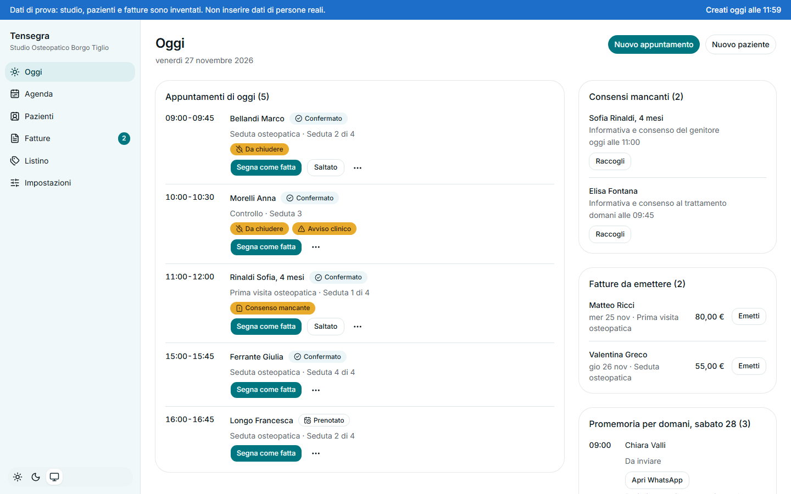
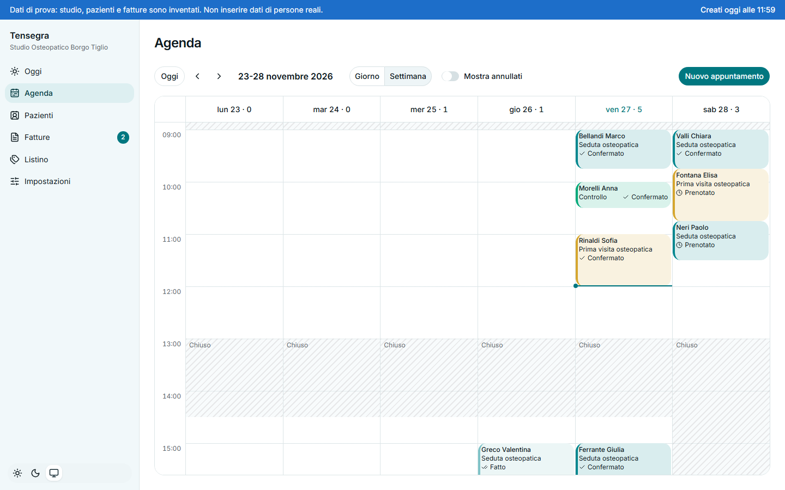
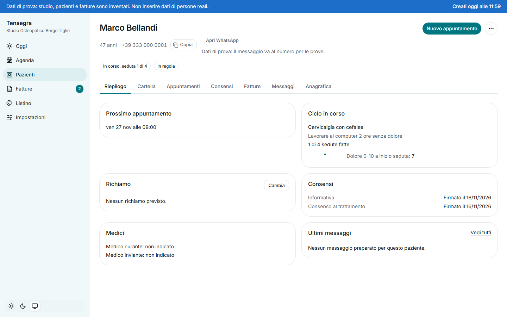

# Tensegra

[](https://github.com/nicholasdotto2-cyber/tensegra/actions/workflows/ci.yml)

A local demo of a practice manager for Italian osteopaths: agenda, clinical record, consents, invoices and backups, in one web app that runs entirely on your own machine.

The user interface is in Italian, because the target users are Italian practitioners. The code, the tests and this README are meant to be read by developers.

| Today | Week agenda | Patient card |
| --- | --- | --- |
|  |  |  |

All names and numbers in the screenshots come from the invented seed data.

## What it does

- **Today and agenda**: a day view of appointments, treatment cycles ("session 2 of 4"), recalls, and appointment states (booked, confirmed, done, no-show, cancelled).
- **Patients and clinical record**: personal data with Italian tax code validation, guardians for minors, visits with structured clinical tests and scales, a body chart, photos, and referral letters to physicians.
- **Consents**: privacy notice and informed consent documents, generated as PDF, with versions and the upload of a signed paper copy.
- **Invoices**: numbering, credit notes, PDF output and FatturaPA XML (the Italian e-invoicing format) validated against the official XSD schema in the tests.
- **Messages**: reminder texts with WhatsApp links. In demo mode every link goes to a single test number.
- **Backups**: `db:backup` and `db:restore` commands for the local database and the uploaded files.
- **Demo mode**: a banner, "DATI DI PROVA" (test data) watermarks on every PDF, and a button that recreates the demo data.

## Stack

- **Next.js 16** (App Router, Server Components, Server Actions, Turbopack) with **React 19** and **TypeScript**.
- **PGlite**: Postgres compiled to WebAssembly, running in-process. No database server to install.
- **15 SQL migrations in Supabase format** with **Row Level Security** on all 40 tables, so each practice only sees its own rows. A small local shim provides the Supabase pieces (roles, `auth` schema) that PGlite lacks.
- **zod** for input validation: every domain command parses its input with a strict schema.
- **Tailwind CSS v4** and shadcn/ui components on Base UI.
- **@react-pdf/renderer** for invoices, consents and referral letters.
- **Vitest** for unit tests and for database tests that run against a real PGlite instance with two practices, to prove the RLS isolation.
- **Playwright** for end-to-end tests on the production build.
- **GitHub Actions** CI: lint, typecheck, unit tests, database tests and build on every push and pull request.

## Run it

Requirements: Node 24.14 or newer, pnpm 11.

```bash
cd web
pnpm install
pnpm db:reset     # creates the local database in web/.data and seeds the demo practice
pnpm dev          # http://127.0.0.1:3000 in demo mode
```

Copy `web/.env.example` to `web/.env.local` only if you want to change the defaults (product name, data folder, fixed clock for tests).

Other useful commands, all from `web/`:

| Command | What it does |
| --- | --- |
| `pnpm db:migrate` | applies the shim and any missing migration |
| `pnpm db:seed` | creates the demo practice if it does not exist yet |
| `pnpm db:reset --empty` | recreates the schema without demo data |
| `pnpm db:backup` / `pnpm db:restore` | backs up and restores the database and the files |
| `pnpm demo:prep` then `pnpm demo` | fresh data, production build, then `next start` in demo mode |

## Tests

| Command | What it runs |
| --- | --- |
| `pnpm lint` | ESLint |
| `pnpm typecheck` | `next typegen` and `tsc --noEmit` |
| `pnpm test:unit` | Vitest unit tests (`tests/unit`) |
| `pnpm test:db` | Vitest database tests on PGlite (`tests/db`) |
| `pnpm test:smoke` | starts the production build and checks a few pages, a query and a PDF |
| `pnpm test:e2e` | Playwright end-to-end tests (`tests/e2e`). Needs `pnpm build` and `pnpm exec playwright install chromium` the first time |
| `pnpm verify` | lint, typecheck, unit, db, build and smoke in one go |

## What is real and what is demo

- It runs **locally only**: a single process opens the data folder, and the dev server listens on 127.0.0.1. There is no hosted version.
- There is **no login or authentication**: the app binds to 127.0.0.1 and must not be exposed on a network.
- **All data is invented**: names, addresses, phone numbers, tax codes (with the fake municipality code X999), VAT numbers and IBANs are placeholders. Photos are drawn silhouettes, signatures are squiggles.
- It is **not in production** and does not send anything: invoices are not transmitted to the Italian exchange system (SdI), and messages are only links.
- It is **not a medical device** and does not give clinical advice. Consent texts and fiscal rules are examples to be checked by a professional before any real use.

## Project layout

```
.github/            CI workflow, Dependabot, pull request template
web/
  src/app/          routes, layouts and Server Actions
  src/components/   UI components (agenda, patients, clinical record, invoices, settings)
  src/lib/          shared helpers: formatting, tax code, phone, consent texts
  src/server/       domain commands and queries, database access, PDF and FatturaPA output, clock
  supabase/         local shim and the 15 SQL migrations
  seed/             invented demo data and image assets
  scripts/          database CLI (migrate, seed, reset, backup, restore) and smoke test
  tests/unit/       Vitest unit tests
  tests/db/         Vitest tests against PGlite
  tests/e2e/        Playwright tests
```

## Author

Nicholas Dotto

Designed and developed by Nicholas Dotto, with Claude Code (Anthropic) as an AI programming assistant.

## License

All rights reserved. The source code is shared so that it can be read and reviewed; no license to use, copy, modify or distribute it is granted. See [LICENSE](LICENSE).
